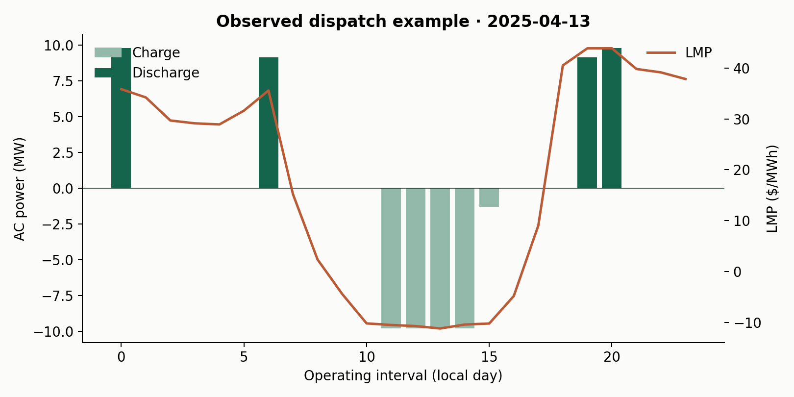
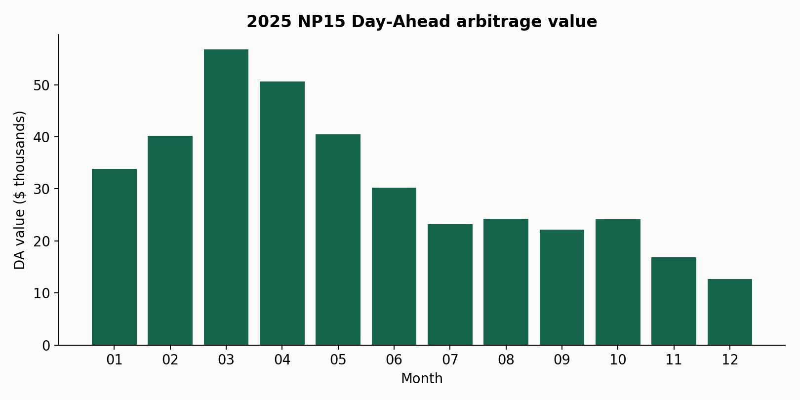
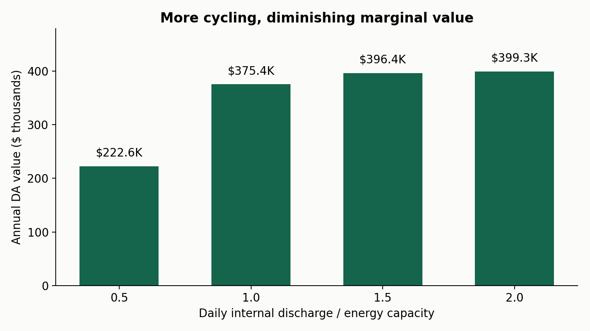
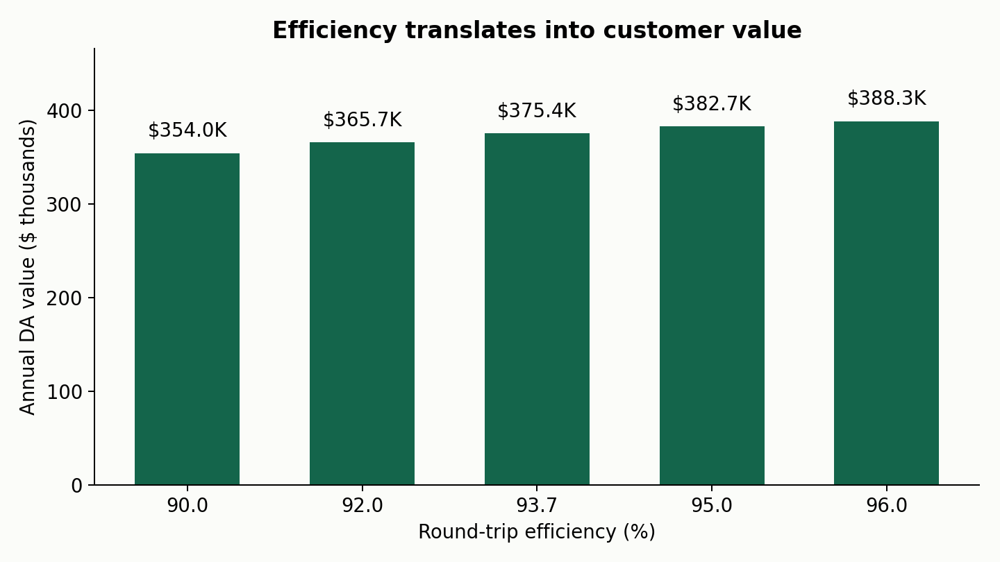
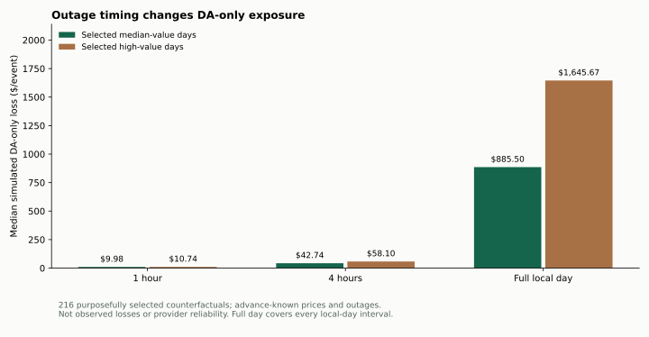
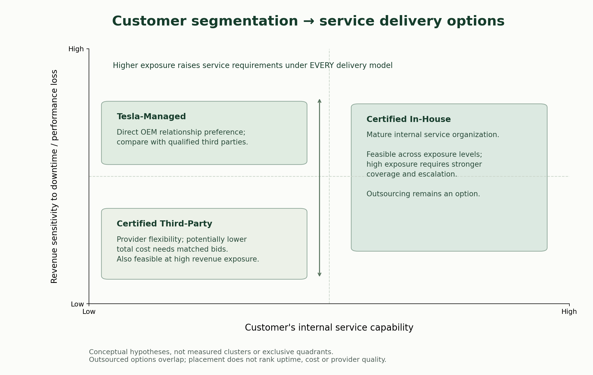

# Megapack Services Techno-Economic Analysis

**How do battery performance and service availability translate into customer economics?**

An independent PM case study using 8,760 hours of 2025 CAISO NP15 Day-Ahead prices, a 10-unit Megapack study configuration, and Python-assisted constrained optimization.

[Read the PM case study](https://richardfu.a2843668904.chatgpt.site/projects/megapack/) · [Methodology](docs/methodology.md) · [Assumptions](docs/assumptions.md) · [Sources](docs/sources.md) · [Limitations](docs/limitations.md)

## Key results

| Measure | Reproduced result |
|---|---:|
| Modeled power / energy | 9.79 MW / 39.16 MWh (rounded: 9.8 / 39.2) |
| Historical hourly prices | 8,760 |
| Annual DA value, after charging purchases | $375,384 |
| Base round-trip efficiency | 93.7% |
| 15-year DA operating PV, net of maintenance | $3,106,017 |
| PV / historical $9,099,280 hardware estimate | 34.1% |
| 1 pp availability, proportional DA-value approximation | $3,754/year (superseded as outage-pricing method) |
| NEW: Four-hour outage loss, sampled median | $49.77/event, DA only, unweighted selected sample |
| NEW: Hourly outage counterfactuals | 216 scenarios across 24 selected day-types |

**DA arbitrage is a narrow value baseline, not complete project valuation.** “Value floor” describes the limited revenue scope, not guaranteed realized revenue: perfect foresight can overstate achievable value within that scope. The operating PV excludes initial investment and must not be called project NPV.

## Role and contribution

Richard designed the analysis around the customer economics question, sourced and validated public data, defined operating assumptions and constraints, and used Python-assisted optimization. The contribution centers on interpreting quantitative evidence for product and service decisions. It does not claim independent hand-written development of a complex optimizer.

The original hourly output and all 12 raw monthly CAISO files were recovered. The first repository revision was created before the prior Python source was rediscovered; the code here remains an explicitly documented **AI-assisted reconstruction**, validated against the original daily economic results. Maximum daily objective difference: under $0.000001. Hourly schedules may differ at equivalent optima.

## Market opportunity

Mean LMP was $38.23/MWh; 288 hours had negative prices; mean daily high–low spread was $35.13/MWh. The model values the timing of spreads subject to battery constraints, rather than treating average price as revenue.




## Method and sensitivities

The daily MILP maximizes discharge sales less charging purchases, with power/energy limits, symmetric efficiency losses, mutually exclusive charge/discharge, and 50% starting/ending SOC. Default daily equivalent full cycles are capped at 1 on an **internal discharged energy** basis. Preserve the 23/25-hour daylight-saving days.

| Maximum daily cycles | Annual DA value |
|---|---:|
| 0.5 | $222,619 |
| 1.0 | $375,384 |
| 1.5 | $396,351 |
| 2.0 | $399,260 |

One daily cycle captures 94.0% of the value modeled with a two-cycle cap. Additional cycling has diminishing value before considering wear.



| RTE | Annual DA value |
|---|---:|
| 90% | $354,041 |
| 92% | $365,666 |
| 93.7% | $375,384 |
| 95% | $382,716 |
| 96% | $388,298 |

93.7% versus 90% adds about $21,343/year in modeled DA value, holding other assumptions fixed.



## Fifteen-year real-dollar scenario

Repeat annual modeled DA value and $55,580 annual maintenance in constant real dollars; discount year-end cash flows at 6% real for 15 years. DA value PV is $3.646M, maintenance PV $0.540M, and net operating PV $3.106M. This is 34.1% of the supplied historical hardware estimate, not a return on investment. Historical price years were not independently reconciled, and no degradation/augmentation or replacement schedule is modeled. See the [cash flows](analysis/15yr_real_dollar_economics.csv) and [scenario sensitivity](analysis/real_dollar_sensitivity.csv).


## New: outage-timing and service-value decision analysis (2026-11-06)

The earlier 1 percentage-point availability-to-revenue shortcut was **too crude to price service**. An extension now re-optimizes daily MILP dispatch after zeroing both charge and discharge power in assumed outage windows. Each month contributes a median-value and high-value day; 1h, 4h and full-day scenarios produce **216 deterministic counterfactuals**.

| Outage length and selected cohort | Sample cases | Median simulated DA loss |
|---|---:|---:|
| 4h on median-value days | 48 | $42.74 |
| 4h on high-value days | 48 | $58.10 |
| Full-day on median-value days | 12 | $885.50 |
| Full-day on high-value days | 12 | $1,645.67 |

Across all **96 purposefully selected 4-hour outages**, the unweighted median DA-only opportunity loss is **$49.77** (sample maximum $870.29). Some 4h outages cost $0 because the optimizer shifts trading to other hours. This is **not a statistically representative loss estimate**: the model has perfect foresight of both outage timing and prices, excludes all non-DA contractual/merchant exposure, and never measures actual provider reliability.

A hypothetical **$20K/year** service premium would require avoiding **~402** such median-sized four-hour events annually to pay for itself from *DA arbitrage alone*. This is a deliberately limited thought experiment, not a service-pricing recommendation. The illustrative three-provider cost comparison uses **invented** internal/third-party prices and event frequencies; no provider ranking follows from it. The historic $55,580 Tesla maintenance amount is not a verified current matched-scope quote.

**Product implication:** collect the customer's full revenue stack, outage/MTTR history, certified workforce, response coverage, warranty scope and matched bids. Only then compare incremental avoided losses and fully loaded fees for Tesla-managed, certified in-house and certified third-party service paths. See [new method, results, limits and validation plan](docs/service_value.md).



## From sensitivity to segmentation

The sensitivities motivate a customer-discovery framework: **service capability** (the owner's own ability to maintain the asset) and **revenue sensitivity** (economic exposure to downtime/performance loss). This is a qualitative hypothesis, not model-derived customer clustering. Cost sensitivity is a separate procurement consideration.



High exposure raises response, restoration and accountability requirements under every delivery model. It does not establish that one provider is inherently better. Low internal capability leaves both outsourced paths open; high capability makes in-house execution feasible without requiring it.

### Three B2B service models evaluated

| Analytical delivery model | Candidate fit / hypothesis | Decision to validate |
|---|---|---|
| Tesla-Managed Service | Owners preferring outsourced execution and direct OEM support | Quoted coverage, exclusions, response/restoration and total lifecycle cost |
| Tesla-Certified In-House Service | Owners with a mature qualified internal service organization | Staffing, certification readiness, geographic coverage, spares and escalation |
| Tesla-Certified Third-Party Service | Owners seeking outsourced execution and provider flexibility | Certification, accountability and matched bids; potentially lower cost remains unverified |

These are three delivery paths derived from Tesla's two described routes, Serviced by Tesla and Certified by Tesla (in-house or third-party), not three official Tesla product tiers. See [official service description](https://www.tesla.com/en_GB/megapack?redirect=no).

**Evidence → recommendation:** efficiency sensitivity motivates diagnostics questions; diminishing cycling value motivates asset-health tradeoffs; the narrow DA availability estimate motivates broader contract-exposure discovery. None of those calculations proves customer preferences or service-price savings.

Recommended next step: discover team readiness and economic exposure, set required service outcomes, then compare equivalent scopes and fully loaded lifecycle costs. Validate with customer interviews, provider bids and contract review. No new service-price, provider-performance or willingness-to-pay estimate is claimed.

Full [customer segmentation, three-model comparison and validation plan](docs/customer_segmentation.md).

## Reproduce

Tested with Python 3.9.6 and the pinned packages below. No network access is required after installation; processed prices are included.

```sh
python3 -m venv .venv
source .venv/bin/activate
python -m pip install -r requirements.txt
python model/run_analysis.py
python model/plot_customer_segmentation.py
python -m unittest discover -s tests -v
```

The run regenerates hourly dispatch, monthly results, cycle/efficiency sensitivities, real-dollar scenarios, four raster figures, 216 outage counterfactuals, service-value tables, and `analysis/summary.json`. It checks data continuity, price agreement, physical balances, SOC/power bounds, no simultaneous charging/discharging, cycle caps, and daily objective agreement against the preserved original output. A failed check stops the run. See [raw-data reconstruction](data/README.md).

```text
model/             data preparation, dispatch, real-dollar economics, full analysis
 data/processed/   hourly prices, original reference, regenerated outputs, source hashes
analysis/          sensitivity tables, 15-year cash flows, outage events, illustrative service values
figures/           four regenerated analytical charts
docs/              methodology, assumptions, sources, limitations
```

## Limitations and source integrity

Perfect foresight; DA only; no RT, ancillary, RA, PPA/tolling, taxes, financing or site-specific interconnection. No full degradation, additional SOC reserve, augmentation or warranty-cost model. The earlier 1 pp availability result is a proportional approximation; the newer experiment explicitly re-optimizes sampled single-day outages but does not infer actual reliability. NP15 is a hub proxy. Other revenue streams may compete for the same physical capacity and must not be added without co-optimization.

Hardware, maintenance, configuration and RTE retain the prior study's user-provided assumptions; Configurator screenshots were not recovered, and these are not current verified quotations. The recovered ATB workbook is background only, not an input to the reproduced constant-dollar cash flow. Full [evidence register](docs/sources.md) and [limitations](docs/limitations.md).

Independent educational project. Not affiliated with or endorsed by Tesla or CAISO.
